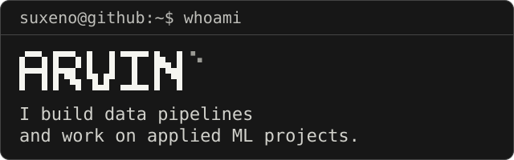
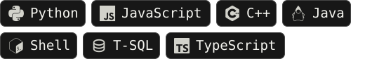
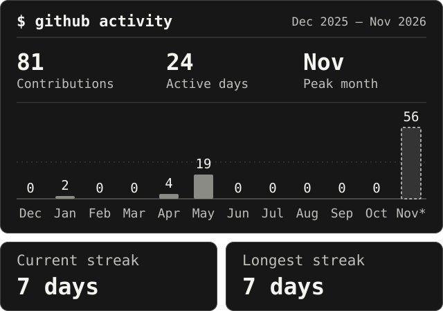

[Portfolio](https://portofolio.arvinantobahtiar.workers.dev/) · [LinkedIn](https://www.linkedin.com/in/arvinanto/) · [Email](mailto:arvinantobahtiar@gmail.com) · [Medium](https://medium.com/@arvinantobahtiar)

Counts reflect what visitors can see on my GitHub profile. <a href="https://github.com/suxeno/suxeno/blob/main/SETUP.md">How the chart updates</a>.
